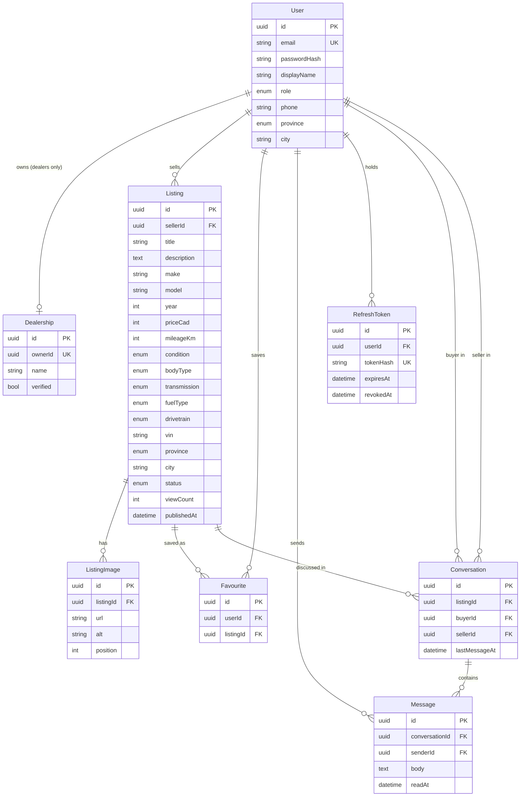

# Data model

The PostgreSQL schema, the relationships between entities, and the invariants the database enforces
rather than trusting application code to maintain.

Source of truth: `apps/api/prisma/schema.prisma`.

## Entity relationships



## Entities

### User

One table for all four roles rather than separate buyer and seller tables. A private seller is also
a buyer; splitting them would mean duplicate accounts for the same person, and marketplace users
routinely cross that line.

`role` is one of `BUYER`, `PRIVATE_SELLER`, `DEALER`, `ADMIN`. Roles are not additive — a user has
exactly one. `ADMIN` satisfies every role check in `RolesGuard`, so admins do not need a seller role
to act on listings.

`email` is unique and stored lowercased (the Zod schema applies `.toLowerCase()` before it reaches
the database), so `Alice@Example.com` and `alice@example.com` cannot both register.

### Dealership

Exists only for `DEALER` accounts, as a one-to-one optional relation keyed by `ownerId`. Registration
creates the user and dealership in a single nested write, because a dealer account without its
dealership is a meaningless half-state.

`verified` is a manual flag with no admin UI yet. It drives the "✓ Verified dealer" badge on listing
detail pages.

### Listing

The central entity.

**`priceCad` is an integer** number of whole Canadian dollars. Floating-point money accumulates
rounding error, and this marketplace has no sub-dollar prices. Anything that needs cents later should
migrate to a `Decimal` column rather than a float.

**`vin` is deliberately not unique.** The same physical vehicle can legitimately be relisted after a
sale, or listed by a dealer after being traded in. A unique constraint would reject valid listings.
Duplicate-VIN detection belongs in moderation tooling, not a database constraint.

**`status`** governs visibility:

| Status | In search | Direct link (public) | Direct link (owner/admin) | Accepts messages |
| --- | --- | --- | --- | --- |
| `DRAFT` | No | 404 | Yes | No |
| `ACTIVE` | Yes | Yes | Yes | Yes |
| `SOLD` | No | Yes | Yes | No |
| `ARCHIVED` | No | 404 | Yes | No |

Unpublished listings return **404 rather than 403** so their existence cannot be confirmed by
probing IDs.

**`publishedAt`** is stamped the first time a listing becomes `ACTIVE` and cleared if it returns to
`DRAFT`. It is what "newest first" sorts by — using `createdAt` would order by when a draft was
started, which is not what a buyer means by "newest".

**`viewCount`** increments on detail views by anyone other than the seller. The increment is
fire-and-forget: a failed counter update logs a warning and never fails the page load.

### ListingImage

Ordered by `position`, zero-based, where position 0 is the primary image shown on cards. Images are
replaced wholesale on update — the client always sends the complete ordered set — which keeps
reordering, insertion, and deletion as one operation instead of three.

### Favourite

A join table with a **unique constraint on `(userId, listingId)`**. This is what makes favouriting
idempotent at the database level: the API uses `upsert`, so a double-tap or a retried request cannot
create duplicates.

### Conversation

**Unique on `(listingId, buyerId)`.** This is the most important invariant in the messaging model: a
buyer has exactly one thread per listing. Messaging the same listing twice continues the existing
conversation instead of fragmenting the history across threads.

`sellerId` is denormalised from the listing rather than joined at read time, because a conversation
must survive independently of listing changes and the inbox query would otherwise join through
listings on every read.

`lastMessageAt` is denormalised so the inbox can sort without aggregating over messages.

### Message

`readAt` is null until the counterparty opens the thread, at which point every unread message from
the other participant is marked read in one `updateMany`. Unread counts are computed as
`readAt IS NULL AND senderId != viewer`.

### RefreshToken

Stores a **SHA-256 digest**, not the token and not a bcrypt hash. The reasoning is in the
[security model](./security.md#why-sha-256-and-not-bcrypt).

`revokedAt` supports rotation and replay detection. Rows are never deleted on logout, only marked
revoked, so a replayed token is distinguishable from an unknown one.

## Indexes

Chosen for the queries that actually run, not speculatively.

| Table | Index | Serves |
| --- | --- | --- |
| `Listing` | `(status, publishedAt)` | Default browse and "newest first" |
| `Listing` | `(status, priceCad)` | Price sorting and price-range filters |
| `Listing` | `(status, make, model)` | Make and model filters |
| `Listing` | `(status, province)` | Location filtering |
| `Listing` | `(sellerId, status)` | Seller dashboard tabs |
| `ListingImage` | `(listingId, position)` | Ordered gallery fetch |
| `Favourite` | `(userId, createdAt)` | The saved-listings page |
| `Conversation` | `(buyerId, lastMessageAt)` | Buyer inbox |
| `Conversation` | `(sellerId, lastMessageAt)` | Seller inbox |
| `Message` | `(conversationId, createdAt)` | Thread rendering |
| `RefreshToken` | `tokenHash` (unique) | Refresh lookup |

**`status` leads every composite index on `Listing`** because search always constrains it first —
public search is hard-coded to `ACTIVE`. An index that did not lead with status would be far less
selective for the queries that matter.

## Cascade behaviour

Every foreign key uses `onDelete: Cascade`. Deleting a user removes their listings, favourites,
messages, and tokens; deleting a listing removes its images, favourites, and conversations.

This is correct for the current product, where deletion means "this never existed". It will need
revisiting when the product needs soft deletion or data retention for dispute resolution — see
[future work](../reference/future-work.md).

## Migrations

Migrations live in `apps/api/prisma/migrations/` and are applied with `prisma migrate deploy` in CI
and production, never `migrate dev` (which can reset data).

To change the schema:

```bash
# Edit apps/api/prisma/schema.prisma, then:
pnpm --filter @atlas/api exec prisma migrate dev --name describe_the_change
```

Review the generated SQL before committing. If the change touches an enum, the corresponding list in
`packages/shared/src/domain.ts` must change in the same commit — see
[changing a shared contract](../guides/development-workflow.md#changing-a-shared-contract).

## Seed data

`apps/api/prisma/seed.ts` creates a realistic Canadian demo marketplace: 8 accounts, 3 dealerships,
21 listings across 6 provinces, favourites, and message threads.

It is **idempotent** — everything is keyed by a natural identifier (user email, listing VIN) and
upserted, so re-running produces identical counts rather than duplicates. CI runs it twice to verify
this.

Listing photos are generated as local SVG files under the API's upload directory rather than
hot-linked, so the demo renders with no network access.
