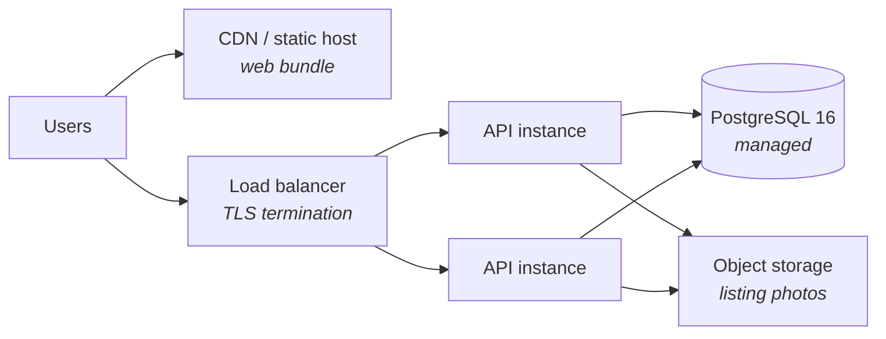

# Deployment

What production needs that local development does not.

> **Status:** Atlas has not been deployed. This is a plan, not a runbook — it describes what the code
> currently supports and what still has to be built or chosen. Items that do not exist yet are marked
> **not yet implemented**.

## Shape of a deployment



Three deployable artefacts:

| Artefact | Build | Runtime |
| --- | --- | --- |
| Web bundle | `pnpm --filter @atlas/web build` → `apps/web/dist` | Any static host or CDN |
| API service | `pnpm --filter @atlas/api build` → `apps/api/dist` | Node ≥ 20.11 |
| Database | — | Managed PostgreSQL 16 |

## Build

```bash
pnpm install --frozen-lockfile
pnpm build      # builds shared first, then both apps
```

The root `build` script builds `packages/shared` before the applications, because the API compiles
against its output. Running an app build in isolation without that step fails on
`Cannot find module '@atlas/shared'`.

The API also needs its Prisma client generated for the deployment platform:

```bash
pnpm --filter @atlas/api exec prisma generate
```

If you build on one platform and run on another — say building on macOS for Linux containers —
generate on the target platform or set the appropriate `binaryTargets` in `schema.prisma`.

## Running the API

```bash
NODE_ENV=production node apps/api/dist/main.js
```

Requires all variables from [configuration](./configuration.md). The process **will refuse to start**
with the example JWT secrets when `NODE_ENV=production` — that is deliberate.

`app.enableShutdownHooks()` is enabled, so `SIGTERM` closes the Prisma connection pool cleanly.
Give containers a termination grace period of at least 10 seconds.

### Health checks

`GET /api/health` returns 200 with `{"status":"ok","database":"up",…}`, or **503** when the database
is unreachable. Use it for both liveness and readiness — an instance that cannot reach the database
should not receive traffic.

## Migrations

Always `deploy`, never `dev`:

```bash
pnpm --filter @atlas/api exec prisma migrate deploy
```

`migrate dev` can reset the database. It exists for local development only.

Run migrations as a **separate step before** rolling out new instances, not on application start.
Multiple instances starting simultaneously would race on the migration lock.

Because migrations run before the new code is live, they must be **backward compatible with the
currently running version** for the duration of the rollout. Adding a nullable column or a new table
is safe. Dropping or renaming a column that the running version still reads is not — split those into
two deploys.

## File storage

**This is the part that needs changing before any real deployment.**

Listing photos are currently written to local disk via `UPLOAD_DIR` and served as static assets. On
more than one instance, an upload handled by instance A is invisible to instance B, and a container
restart loses everything.

Options, roughly in order of effort:

1. **Shared network volume.** Smallest change — set `UPLOAD_DIR` to a mounted volume. Works for a
   single instance or a small fixed set. Does not scale well and makes backups awkward.
2. **Object storage (recommended).** Replace `apps/api/src/modules/uploads/uploads.controller.ts`
   with an S3-compatible upload. The response contract is already `{ url }`, so **nothing else in
   the codebase changes** — that seam was left deliberately. Serve through a CDN.
3. **Direct-to-storage uploads.** Issue presigned URLs so files never transit the API. Best at scale;
   more moving parts.

Whichever you choose, seeded demo images are written under `<UPLOAD_DIR>/seed/` and would need the
same treatment if you seed a deployed environment.

## Serving the web app

`apps/web/dist` is a static bundle. Two requirements:

**SPA fallback.** Unknown paths must serve `index.html`, or a hard refresh on `/listings/<id>`
returns 404 from the static host rather than reaching React Router.

**API reachability.** Either:

- Serve the web app and proxy `/api` and `/uploads` from the same origin — simplest, avoids CORS
  entirely, and keeps `VITE_API_URL` at its `/api` default; or
- Host separately, set `VITE_API_URL` to the absolute API URL, and add that origin to
  `CORS_ORIGINS`.

`VITE_` variables are baked in at build time, so a change to `VITE_API_URL` requires a rebuild, not
just a restart.

## Reverse proxy

Expected to handle:

- **TLS termination.** The API speaks HTTP behind it.
- **`X-Forwarded-*` headers.** If you rely on client IPs for rate limiting, enable Express trust
  proxy — **not yet implemented**; without it every request appears to come from the proxy and the
  global rate limit becomes effectively shared.
- **Request body limits**, as a layer in front of `MAX_UPLOAD_BYTES`.
- **Compression** for JSON and static assets.

## Scaling notes

**The API is stateless** apart from local uploads — sessions live in tokens and the database — so it
scales horizontally once file storage is externalised.

**Rate limiting is per-instance and in-memory.** With N instances the effective limit is N times the
configured value. A shared store is needed for meaningful limits at more than one instance —
**not yet implemented**.

**Database connections** are the usual first ceiling. Set `connection_limit` in `DATABASE_URL` such
that instances × limit stays under the server's `max_connections`, and consider PgBouncer beyond a
handful of instances.

**No caching layer exists.** Every read hits PostgreSQL. The search endpoint with facets issues five
queries per request and is the obvious first candidate for caching.

## Observability

Currently: structured logs to stdout via the Nest logger, and the health endpoint. That is the
honest extent of it.

Before carrying real traffic you want request logging with correlation ids, error tracking, metrics
(latency, error rate, database pool saturation), and alerting on health-check failures. All
**not yet implemented**.

## Backups

Not configured — no deployment exists. When one does: automated PostgreSQL backups with
point-in-time recovery, **restores actually tested**, and separate backups for uploaded images if
they are not in object storage with versioning.

## Deployment checklist

Before the first production deploy:

- [ ] Real JWT secrets generated, stored in a secret manager, never in the repository
- [ ] `NODE_ENV=production`
- [ ] `CORS_ORIGINS` set to real origins only
- [ ] File storage moved off container-local disk
- [ ] Managed PostgreSQL with automated, tested backups
- [ ] Migrations run as a discrete pre-deploy step
- [ ] Health checks wired to liveness and readiness
- [ ] TLS terminated, HTTP redirected
- [ ] Error tracking and log aggregation in place
- [ ] Rate limiting backed by a shared store if running more than one instance
- [ ] `SECURITY.md` published with a disclosure contact
- [ ] Restore procedure rehearsed at least once

Related: [configuration](./configuration.md) · [security model](../architecture/security.md) ·
[future work](../reference/future-work.md)
