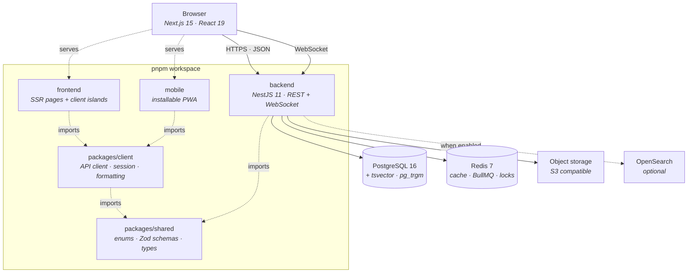
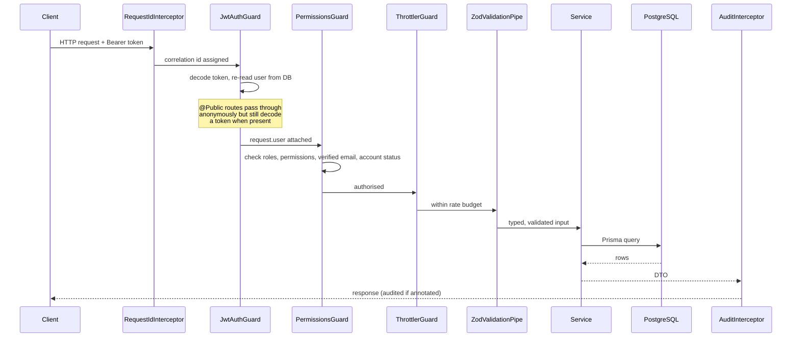
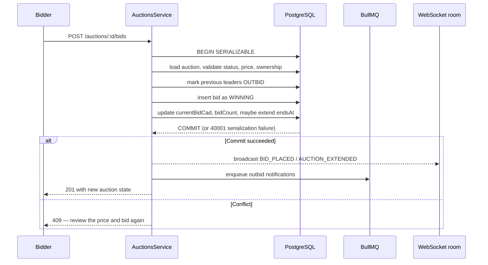

# System architecture

How Vintrax is put together, why the pieces are separated the way they are, and
what happens when a request arrives.

> Deeper material lives in [architecture/](./architecture/) — this document is
> the entry point the developer guide points at.

## System shape



Four things are worth noticing.

**No client talks to the database.** All persistence goes through the API,
which is what made the second client — Vintrax Mobile — a matter of calling the
same endpoints rather than reimplementing business rules. See
[mobile.md](./mobile.md).

**`packages/shared` is imported by both applications.** It is the contract, and
both sides compile against it, so a mismatch is a build failure rather than a
runtime bug found by a user.

**Search and storage sit behind provider interfaces.** PostgreSQL full-text
search and local disk are the defaults; OpenSearch and S3 are selected by
environment variable. The platform therefore boots in development and CI without
a search cluster or an object store.

**Redis is optional but load-bearing at scale.** Cache reads degrade to
pass-through when it is unavailable, and the queue falls back to an inline
driver — but distributed locks and shared rate limiting need it once more than
one instance is running.

## Component responsibilities

### `packages/shared`

Domain vocabulary and wire contract. No I/O, no framework code, no environment
access — pure data definitions, which is what lets a Node service and a browser
bundle both consume it.

| File               | Contents                                                                                     |
| ------------------ | -------------------------------------------------------------------------------------------- |
| `src/domain.ts`    | Enum value lists, the role/permission matrix, bid increment bands, fee rules, display labels |
| `src/schemas.ts`   | Zod schemas for every request payload and query string                                       |
| `src/contracts.ts` | TypeScript interfaces for every response body                                                |

### `packages/client`

What both browser applications must agree on: the API client and its token
refresh, the session store, the auction socket subscription, and display
formatting. No framework or router code, so a third client inherits the same
behaviour rather than a slightly different copy of it.

The enum lists here and the Prisma enums mirror each other exactly. Changing one
without the other is a bug — see
[changing a shared contract](./guides/development-workflow.md#changing-a-shared-contract).

### `backend`

NestJS organised by feature module. Each module owns a controller (HTTP shape),
a service (business rules), and where useful a mapper (rows to DTOs).

```
backend/src/
├── main.ts                 Bootstrap: helmet, CORS, static files, Swagger
├── app.module.ts           Module wiring, global guards, filters, interceptors
├── config/env.ts           Environment schema and fail-fast validation
├── common/
│   ├── prisma/             Database client and lifecycle
│   ├── redis/              Cache, distributed locks
│   ├── queue/              BullMQ with an inline fallback driver
│   ├── storage/            Local and S3 drivers behind one interface
│   ├── search/             PostgreSQL and OpenSearch providers
│   ├── mail/               Log and SMTP drivers
│   ├── audit/              Append-only audit trail
│   ├── guards/             JWT authentication, permissions
│   ├── pipes/              Zod validation
│   ├── filters/            Uniform error mapping
│   └── interceptors/       Request correlation, audit recording
└── modules/
    ├── auth/               Registration, sign-in, rotation, verification, reset
    ├── users/              Profile, addresses, admin user management
    ├── dealers/            Profiles, verification workflow, seller analytics
    ├── vehicles/           Inventory CRUD, search, moderation
    ├── inspections/        Condition reports
    ├── auctions/           Lifecycle, bidding engine, WebSocket gateway, worker
    ├── favourites/         Saved vehicles
    ├── messaging/          Buyer–seller conversations
    ├── notifications/      In-app and email fan-out
    ├── transactions/       Orders, payments, settlement
    ├── uploads/            Image and document upload
    ├── search-index/       Index maintenance worker
    ├── admin/              Platform analytics, audit querying
    └── health/             Liveness and readiness probes
```

### `frontend`

Next.js App Router. Public pages that matter for search engines render on the
server; anything interactive is a client component. It holds no business rules —
every rule it appears to enforce is also enforced server-side.

See [frontend.md](./frontend.md).

## Request lifecycle



Guard order is deliberate: authenticate, authorise, then rate-limit.
Authorisation needs to know who the caller is, and rate limiting should not
spend budget deciding that an anonymous caller was never allowed in.

**The JWT strategy re-reads the user on every request.** That costs one indexed
lookup and buys immediate effect for suspension, deletion and role changes,
instead of waiting up to fifteen minutes for a token to expire.

## Data flow: placing a bid

The most correctness-sensitive path in the platform.



Serializable isolation is what makes this correct: two bidders hitting the same
auction at the same instant cannot both be told they are winning. PostgreSQL
aborts one, and the caller sees a conflict rather than a silently lost bid.

Verified under load — ten simultaneous bids produced two accepted, seven
serialization conflicts and one below-minimum rejection, leaving exactly one
`WINNING` row.

## Boundaries kept open on purpose

| Seam                       | Today                | Enables                                      |
| -------------------------- | -------------------- | -------------------------------------------- |
| API as a separate service  | Serves the web app   | Mobile clients, partner integrations         |
| Storage provider interface | Local disk           | Object storage with no call-site changes     |
| Search provider interface  | PostgreSQL full-text | A dedicated cluster when volume justifies it |
| Queue driver               | BullMQ over Redis    | Inline execution in dev and CI               |
| Mail driver                | Log                  | SMTP, or a transactional provider            |
| `@vintrax/shared` contract | Two consumers        | A third inherits validation for free         |

## What this architecture does not do

Stated plainly so nobody assumes otherwise:

- **No read replicas or sharding.** One primary database.
- **No distributed tracing.** Correlation ids only.
- **No CDN in front of the API.** Only media is expected behind one.
- **Payments are recorded, not processed.** There is no gateway integration —
  `POST /orders/:id/payment` records a provider reference that something else
  produced.

See [future work](./reference/future-work.md).
