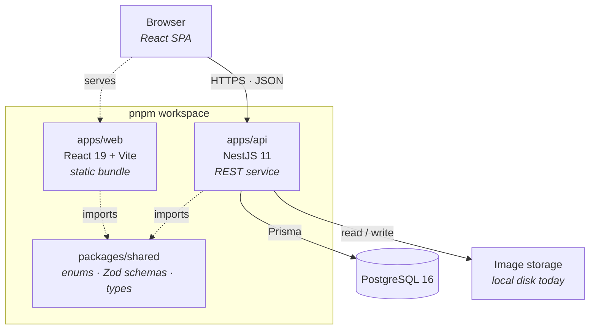
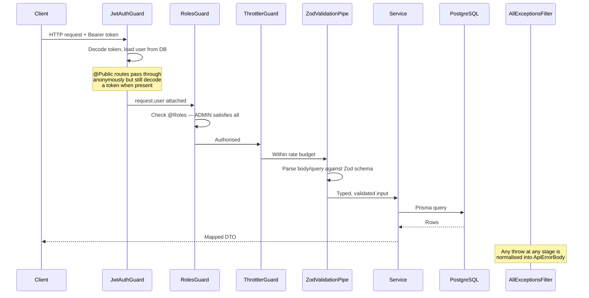

# Architecture overview

How Vintrax is put together, why the pieces are separated the way they are, and what happens when a
request arrives.

## System shape

Vintrax is a pnpm workspace containing two deployable applications over one shared contract package.



Three things are worth noticing about this diagram.

**The web app never talks to the database.** All persistence goes through the API. This is what
makes a second client — the auction application, a mobile app — a matter of calling the same
endpoints rather than reimplementing business rules.

**`packages/shared` is imported by both applications**, not just referenced by one. It is the
contract, and both sides compile against it.

**Image storage is drawn as a separate box** even though it is currently a directory on disk,
because it is the piece most likely to move to object storage first.

## Why the API is a separate service

The obvious alternative was a single Next.js application with server actions or route handlers doing
the persistence. That would have been faster to build and simpler to deploy.

It was rejected because of [D-006](../decision-log.md): auctions are a planned separate application
that should share accounts, vehicle data, images, notifications, and potentially messaging. Logic
embedded in a web app's server routes has to be extracted before a second product can use it, and
extraction under deadline is where shortcuts get taken. Paying the separation cost at the start is
cheaper than paying it during Phase 4.

The same reasoning covers a future mobile client, which the HQ document lists under Phase 4
ecosystem expansion.

## Component responsibilities

### `packages/shared`

The domain vocabulary and the wire contract. It contains no I/O, no framework code, and no
environment access — it is pure data definitions, which is what lets both a Node service and a
browser bundle consume it.

| File               | Contents                                                                          |
| ------------------ | --------------------------------------------------------------------------------- |
| `src/domain.ts`    | Enum value lists (`BODY_TYPES`, `PROVINCES`, …), display labels, domain constants |
| `src/schemas.ts`   | Zod schemas for every request payload and query string                            |
| `src/contracts.ts` | TypeScript interfaces for every response body                                     |

The enum lists here and the Prisma enums in `apps/api/prisma/schema.prisma` mirror each other
exactly. Changing one without the other is a bug; see
[the shared contract change process](../guides/development-workflow.md#changing-a-shared-contract).

### `apps/api`

A NestJS application organised by feature module. Each module owns a controller (HTTP shape), a
service (business rules), and where useful a mapper (database rows to response DTOs).

```
apps/api/src/
├── main.ts                    Bootstrap: helmet, CORS, static files, Swagger
├── app.module.ts              Module wiring and global guards/filters
├── config/env.ts              Environment schema and fail-fast validation
├── common/
│   ├── prisma/                Global Prisma module and lifecycle
│   ├── pipes/                 Zod validation pipe
│   ├── filters/               Uniform error mapping
│   ├── guards/                JWT authentication, role authorisation
│   ├── decorators/            @Public, @Roles, @CurrentUser
│   └── auth/auth-user.ts      Authenticated principal and token payload types
└── modules/
    ├── auth/                  Registration, login, refresh rotation, logout
    ├── users/                 Self-view of an account
    ├── listings/              CRUD, search, facets, visibility rules
    ├── favourites/            Save and unsave
    ├── messaging/             Conversations and messages
    ├── uploads/               Listing photo upload
    └── health/                Liveness and database readiness
```

### `apps/web`

A React single-page application. It holds no business rules — every rule it appears to enforce
(who may list a vehicle, which listings are visible) is also enforced server-side, because a browser
cannot be trusted. Client-side checks exist to avoid showing users doors they cannot open.

See [web app architecture](./web-app.md) for its internal structure.

## Request lifecycle

Every API request passes through the same pipeline. Understanding it explains most of the
"where does this behaviour live" questions.



The guard order is deliberate and set in `app.module.ts`: authenticate, then authorise, then
rate-limit. Authorisation needs to know who the caller is, and rate limiting should not consume
budget deciding that an anonymous caller was never allowed in.

### Optional authentication

`JwtAuthGuard` does something slightly unusual: on routes marked `@Public()`, it allows anonymous
callers through **but still decodes a valid token if one is present**.

This is what lets `GET /api/listings` serve both audiences from one controller method. An anonymous
visitor gets listings; a signed-in visitor gets the same listings with `isFavourited` populated.
Without it, the alternatives are two near-identical endpoints or a second round trip to fetch
favourite state.

## Data flow: a search request

Worth tracing once, because search is the most involved read path.

1. The browser holds all filter state in the URL (`/listings?fuelType=ELECTRIC&sort=PRICE_ASC`).
2. `parseFilters` converts `URLSearchParams` into a filter object; `filtersToApiQuery` converts it
   back into the query string sent to the API.
3. `searchListingsSchema` parses and coerces that query server-side — string `"24"` becomes number
   `24`, comma-separated `"SUV,TRUCK"` becomes `['SUV', 'TRUCK']`, and defaults are applied.
4. `ListingsService.buildSearchWhere` translates the parsed query into a Prisma `where` clause,
   always constrained to `status: 'ACTIVE'`.
5. Three queries run: a `count`, a paged `findMany`, and three `groupBy` calls for facet counts.
6. A separate query resolves which of the returned listings the viewer has favourited — deliberately
   a second query rather than a correlated subquery, so the Prisma select stays statically typed.
7. Rows are mapped to `ListingSummary` DTOs and returned with pagination metadata and facets.

## Boundaries that exist for the future

These are places where the current implementation is simple but the seam is already cut.

| Seam                                      | Today                         | Enables                                               |
| ----------------------------------------- | ----------------------------- | ----------------------------------------------------- |
| API as a separate service                 | Serves one web client         | Auction app, mobile app ([D-006](../decision-log.md)) |
| `POST /uploads/images` returns a URL      | Writes to local disk          | Swap to object storage without touching listing code  |
| `@vintrax/shared` holds the contract      | Two consumers                 | A third consumer inherits validation for free         |
| Messaging keyed by `(listingId, buyerId)` | Marketplace listings          | Auction lots could reuse the thread model             |
| `RefreshToken` rows are revocable         | Rotation and replay detection | Session management UI, forced logout                  |

## What this architecture does not do

Stated plainly so nobody assumes otherwise:

- **No background job processing.** Everything happens in the request cycle. Email, notifications,
  and inventory imports will need a queue.
- **No caching layer.** Every read hits PostgreSQL. Fine at demo scale, not at marketplace scale.
- **No real-time transport.** Messaging is polled, per [D-005](../decision-log.md) favouring
  reliable asynchronous messaging over live chat in the first version.
- **No multi-region or read-replica awareness.** One database, one connection pool.

See [future work](../reference/future-work.md) for when each of these becomes necessary.
