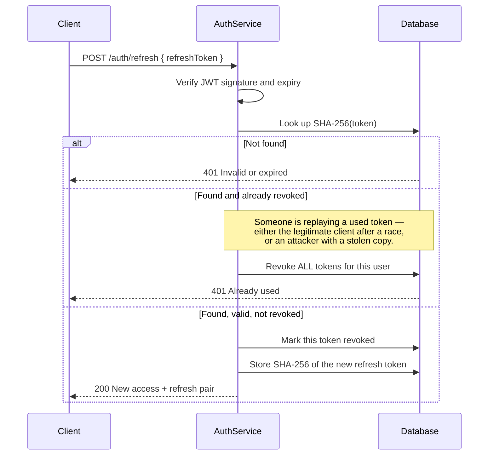

# Security model

How Vintrax authenticates, authorises, and validates — and what it deliberately does not yet address.

Security is a foundation concern per guiding principle 7 in the [HQ document](../vintrax-hq.md), so
these choices were made at build time rather than deferred.

## Authentication

### Password storage

Passwords are hashed with **bcrypt at cost factor 12** (`apps/api/src/modules/auth/auth.service.ts`).
Bcrypt was chosen over a bare SHA family because it is deliberately slow and salted per-password;
cost 12 is a reasonable 2020s balance between resistance and login latency.

Minimum length is 10 characters, maximum 128. There is no composition requirement (no "must contain
a symbol") — length dominates entropy, and composition rules push users toward predictable
substitutions.

### Login timing

A login attempt for an unknown email still performs a bcrypt comparison against a dummy hash:

```ts
const passwordMatches = await bcrypt.compare(
  input.password,
  user?.passwordHash ?? '$2a$12$invalidinvalid...',
);
```

Without this, an unknown email returns in microseconds while a known one takes ~100 ms, letting an
attacker enumerate registered addresses by timing alone. The error message is also identical in both
cases: `Invalid email or password`.

### Token model

Two tokens, different lifetimes and different secrets:

| Token   | Default TTL | Secret               | Purpose                  |
| ------- | ----------- | -------------------- | ------------------------ |
| Access  | 15 minutes  | `JWT_ACCESS_SECRET`  | Sent on every request    |
| Refresh | 30 days     | `JWT_REFRESH_SECRET` | Exchanged for a new pair |

Separate secrets mean a leaked access secret cannot be used to mint refresh tokens. The environment
schema **rejects configurations where the two secrets are equal**.

The access token payload is deliberately minimal — `sub`, `email`, `role`. It carries no permissions
beyond the role, so a stale token cannot grant more than the role allows.

**The JWT strategy re-reads the user from the database on every request** rather than trusting the
token's claims. This costs one indexed lookup and buys immediate effect for account deletion and
role changes, instead of waiting up to 15 minutes for the token to expire.

### Refresh token rotation

Refresh is not a simple "present token, get new token". It rotates and detects reuse:



Revoking the whole family on replay is the important part. A stolen refresh token becomes a
**self-limiting, detectable event**: whoever uses it second is logged out, and the incident is
logged with the user id. The cost is that a genuine client racing itself gets logged out, which is
why the web client deduplicates concurrent refreshes into a single in-flight call.

### Why SHA-256 and not bcrypt

Refresh tokens are stored as an **unsalted SHA-256 digest**. This looks wrong next to bcrypt for
passwords, and the difference matters:

- A bcrypt hash is salted, so the same input produces different output every time. You cannot
  `SELECT ... WHERE tokenHash = ?` — you would have to load every token row and compare one by one.
- A refresh token is already 200+ bits of cryptographic randomness. It is not guessable, so the
  brute-force resistance bcrypt provides for low-entropy human passwords buys nothing here.
- What we actually need is a value that is **useless if the database leaks** but **directly
  queryable** for revocation. An unsalted digest of a high-entropy secret is exactly that.

### Client-side token storage

The web client stores both tokens in `localStorage`. This is a **known trade-off**: `localStorage` is
readable by any script running on the origin, so a successful XSS can exfiltrate a session.

The more secure alternative is refresh tokens in `HttpOnly; Secure; SameSite` cookies with CSRF
protection, keeping the access token in memory only. That is the right target before handling real
user data — see [future work](../reference/future-work.md#authentication-hardening).

## Authorisation

Three layers, all server-side. The web app's checks are for user experience only and are never the
enforcement point.

### 1. Authentication guard

`JwtAuthGuard` is registered globally, so **routes are authenticated by default** and must opt out
with `@Public()`. This fails safe: forgetting a decorator makes an endpoint too strict, not too open.

On `@Public()` routes it still decodes a token when present, which is what allows anonymous and
signed-in visitors to share one controller method while only the latter gets `isFavourited`.

### 2. Role guard

`@Roles('DEALER', 'PRIVATE_SELLER')` restricts an endpoint. `ADMIN` satisfies every check.

Roles are coarse — they answer "may this kind of account do this kind of thing", not "may this
account touch this row".

### 3. Ownership checks

Row-level rules live in the services, because only they know the data:

| Rule                                                                | Where                                 |
| ------------------------------------------------------------------- | ------------------------------------- |
| Only the seller (or admin) may edit or delete a listing             | `ListingsService.requireOwnedListing` |
| Only participants may read or reply to a conversation               | `MessagingService.assertParticipant`  |
| A seller cannot message their own listing                           | `MessagingService.startConversation`  |
| The message recipient is derived from the listing, never the client | `MessagingService.startConversation`  |

### Enumeration resistance

Unpublished listings return **404, not 403**, to callers who are not the owner. A 403 confirms the
resource exists; iterating UUIDs would let someone map unreleased inventory. The same reasoning
drives the identical login error for unknown and wrong-password cases.

## Input validation

Every request body and query string is parsed by a Zod schema from `@vintrax/shared` before reaching a
service. Handlers therefore receive data that is already typed, coerced, and range-checked.

This matters beyond tidiness:

- **Unknown fields are stripped**, so a client cannot smuggle `role: "ADMIN"` into a registration
  payload and have it reach Prisma.
- **Coercion is explicit** — query strings arrive as strings and become numbers only where a schema
  says so.
- **The web app validates against the same schemas**, so client and server agree by construction
  rather than by convention.

Path parameters that should be UUIDs use `ParseUUIDPipe`, so a malformed id is a 400 before any query
runs.

### SQL injection

All database access goes through Prisma's query builder. Where raw SQL is unavoidable — full-text
ranking, trigram fallback, and the daily-series analytics — it uses Prisma's tagged
`$queryRaw` template, which parameterises every interpolation.

The one exception is `admin.service.ts:81`, which uses `$queryRawUnsafe` to vary a table and column
name that a query builder cannot parameterise. Both come from file-local string literals and neither
is reachable from a request, so it is not injectable today — but it is the one place where a future
edit could make it so, and it is tracked as A-13 in the [security audit](../security-audit.md).

## Upload handling

`POST /api/uploads/images`, `/uploads/inspection-images` and `/uploads/documents` are the endpoints
accepting binary input, each restricted by permission — `vehicle:write` for photos and documents,
`inspection:write` for inspection photos. Their defences:

1. **Held in memory until validated** — nothing touches disk before the type and size checks pass.
2. **MIME allowlist**, not a blocklist: `image/jpeg`, `image/png`, `image/webp`, `image/avif`.
3. **The extension comes from the validated MIME type**, not the filename.
4. **The filename is generated** (`randomUUID()`), discarding the client's entirely — no path
   traversal, no `photo.jpg.php`.
5. **Size ceiling** from `MAX_UPLOAD_BYTES`, 5 MB by default.

> The MIME type is taken from the request rather than sniffed from file content. A crafted file could
> claim `image/png` while containing something else. Since files are served as static assets and
> never executed, the practical risk is low, but content sniffing belongs in the hardening pass.

### What is served, and to whom

Only the photo folders are mounted as static assets — `vehicles/`, `inspections/` and the seed
images. `documents/` is not, because vehicle paperwork carries the owner's name, address and VIN
history. Documents are served by `GET /api/vehicles/:id/documents/:documentId`, which authorizes
the caller as the seller, an administrator, or the buyer on an order that has not been cancelled,
and returns the file as an attachment with `Cache-Control: private, no-store`.

The mount is an allowlist rather than a denylist of one folder: a folder added later and forgotten
returns 404, which someone notices. The reverse mistake is silent.

A document's recorded URL arrives in the payload a seller sends, so it is attacker-controlled. It is
resolved against the upload directory and then checked to still be inside it, which is what stops
`../` — and an absolute path, which would otherwise override the join — from reading anything else
on the host.

> With `STORAGE_DRIVER=s3` the objects are served by the bucket, so this authorization only governs
> _disclosure of the URL_. The bucket must be private for it to mean anything; the development MinIO
> setup sets `mc anonymous set download`, which is fine for demo images and wrong for documents.

## Transport and headers

- **Helmet** sets standard protective headers. `crossOriginResourcePolicy` is relaxed to
  `cross-origin` because listing images are served from the API origin and embedded by the web app
  on a different port in development.
- **CORS** is an explicit allowlist from `CORS_ORIGINS`, not a wildcard.
- **HTTPS termination** is expected at the reverse proxy or load balancer; the API speaks HTTP behind
  it.

## Rate limiting

| Scope                  | Budget             |
| ---------------------- | ------------------ |
| Global                 | 300 requests / 60s |
| Registration and login | 10 requests / 60s  |

The tighter credential budget is what makes online password guessing impractical. Limits are
**per-instance and in-memory** — horizontal scaling needs a shared store, noted in
[future work](../reference/future-work.md).

## Secrets and configuration

Configuration is validated by a Zod schema at boot (`apps/api/src/config/env.ts`). A missing or
malformed variable **stops the process with a readable report** rather than surfacing later as a
runtime 500.

The schema specifically refuses to start when `NODE_ENV=production` and either JWT secret still holds
its `.env.example` placeholder. Committing a real `.env` is prevented by `.gitignore`.

Generate production secrets with:

```bash
openssl rand -base64 48
```

## Error disclosure

The global exception filter maps everything to a uniform body. Unexpected errors return a generic
`An unexpected error occurred` while the stack trace goes to server logs only. Known Prisma errors
are translated to appropriate status codes (`P2002` → 409, `P2025` → 404) without exposing schema
internals.

## Not yet addressed

Honest list of gaps. None are oversights — each is Phase 2 work.

| Gap                               | Impact                                     | Notes                              |
| --------------------------------- | ------------------------------------------ | ---------------------------------- |
| Tokens in `localStorage`          | XSS can steal a session                    | Move refresh to `HttpOnly` cookies |
| No email verification             | Accounts can use addresses they do not own | Needs email delivery first         |
| No password reset                 | Users cannot recover accounts              | Needs email delivery first         |
| No 2FA                            | Account takeover needs only a password     | Consider for dealer accounts first |
| No CSP                            | Reduces XSS defence in depth               | Needs an audit of inline styles    |
| Rate limits are per-instance      | Ineffective across replicas                | Needs Redis-backed storage         |
| No audit log                      | Admin and moderation actions untraceable   | Needed before real moderation      |
| MIME type is trusted, not sniffed | Mislabelled uploads possible               | Add magic-byte inspection          |
| No account lockout                | Slow distributed guessing possible         | Rate limits only slow it           |
| Message content unmoderated       | Spam and abuse vector                      | Trust and safety is Phase 2        |

## Reporting

There is no security contact yet, since the platform is pre-launch with no real user data. Add a
`SECURITY.md` with a disclosure process before the first public deployment.
