# Roles and transaction flows

Who can do what in Atlas, and how each process actually moves through the
system. Every permission, endpoint and status in this document is taken from
the code — `packages/shared/src/domain.ts` for the matrix,
`backend/prisma/schema.prisma` for the state machines, and the controllers for
the guards.

## How authorisation works

Four things gate every request, in this order:

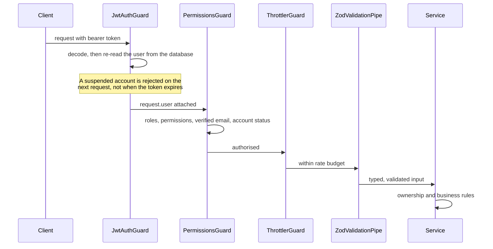

Two properties worth stating plainly:

- **Permissions are ANDed.** `@RequirePermissions('vehicle:publish', 'user:manage')`
  needs both. This is what keeps a dealer — who has `vehicle:publish` for their
  own listings — out of the moderation queue.
- **The guard is not the last line.** Ownership is checked in the service. A
  seller with `vehicle:write` can write *their* vehicles; the service throws
  `ForbiddenException` for anyone else's.

## The permission matrix

The complete matrix, verbatim from `ROLE_PERMISSIONS`.

| Permission | Buyer | Seller | Dealer | Inspector | Admin | Super admin |
| --- | :-: | :-: | :-: | :-: | :-: | :-: |
| `vehicle:read` | ✅ | ✅ | ✅ | ✅ | ✅ | ✅ |
| `vehicle:write` | | ✅ | ✅ | | ✅ | ✅ |
| `vehicle:publish` | | ✅ | ✅ | | ✅ | ✅ |
| `vehicle:delete` | | ✅ | ✅ | | ✅ | ✅ |
| `auction:read` | ✅ | ✅ | ✅ | | ✅ | ✅ |
| `auction:create` | | ✅ | ✅ | | ✅ | ✅ |
| `auction:manage` | | | | | ✅ | ✅ |
| `bid:place` | ✅ | ✅ | ✅ | | | ✅ |
| `inspection:read` | ✅ | ✅ | ✅ | ✅ | ✅ | ✅ |
| `inspection:write` | | | | ✅ | ✅ | ✅ |
| `dealer:read` | | | ✅ | | ✅ | ✅ |
| `dealer:manage` | | | | | ✅ | ✅ |
| `dealer:verify` | | | | | ✅ | ✅ |
| `user:read` | | | | | ✅ | ✅ |
| `user:manage` | | | | | ✅ | ✅ |
| `payment:read` | | | ✅ | | ✅ | ✅ |
| `payment:manage` | | ✅ | ✅ | | ✅ | ✅ |
| `report:read` | | | ✅ | | ✅ | ✅ |
| `settings:manage` | | | | | | ✅ |
| `audit:read` | | | | | ✅ | ✅ |

Four deliberate gaps:

- **A dealer cannot verify a dealership** — not even their own. Self-verification
  would make the verified badge worthless.
- **An inspector cannot bid and cannot list.** Their independence is the product.
- **An admin cannot bid.** Only `SUPER_ADMIN` holds `bid:place` among staff
  roles, and that is an artefact of holding every permission rather than an
  invitation to trade on the platform they moderate.
- **A buyer does not hold `payment:manage`.** Recording that money arrived is
  the seller's side of a sale; a buyer able to assert it about their own order
  could take a vehicle without paying. The permission is a floor, not the whole
  rule — the service also requires the caller to be the seller on that specific
  order, so a dealer buying from another dealer is refused too.

---

# Roles

## Buyer

The default role. Anyone who registers is a buyer until they ask to be
something else.

| Can | Cannot |
| --- | --- |
| Search and view listings, including as a guest | Create or edit a listing |
| Save vehicles to favourites | Run an auction |
| Message sellers | See another buyer's identity in a bid history |
| Bid in live auctions | See a reserve price |
| Buy at a fixed price, pay, complete an order | Read inspection reports before they are published |
| Read published inspection reports | |

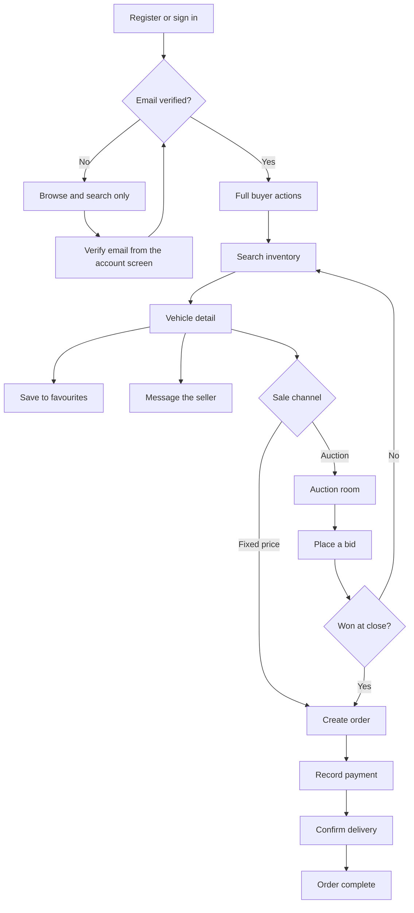

**The verified-email gate is real.** `POST /vehicles`, `POST /auctions`,
`POST /auctions/:id/bids` and `POST /orders` all carry
`@RequireVerifiedEmail()`. Browsing does not.

## Seller

A private individual selling their own vehicles. Everything a buyer can do,
plus inventory.

| Can | Cannot |
| --- | --- |
| Everything a buyer can | Moderate anyone's listing, including their own |
| Create, edit, delete their own listings | See the moderation queue |
| Submit a listing for review | Verify a dealership |
| Publish their own listing once approved | See platform analytics |
| Create and cancel auctions on their own vehicles | Read another seller's inventory |
| Set a reserve price, never shown to bidders | |

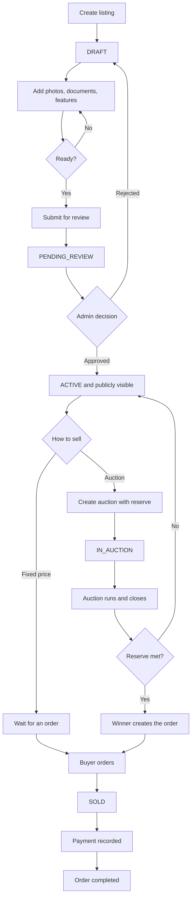

## Dealer

A dealership. A seller with a business identity attached, plus the reporting
that comes with it.

| Can | Cannot |
| --- | --- |
| Everything a seller can | Verify their own dealership |
| Hold a dealership profile with a public page | Verify any dealership |
| See their own sales and inventory analytics | See platform-wide analytics |
| Read payment records for their own sales | Manage other users |
| Carry a verified badge once an admin approves it | Read the audit log |

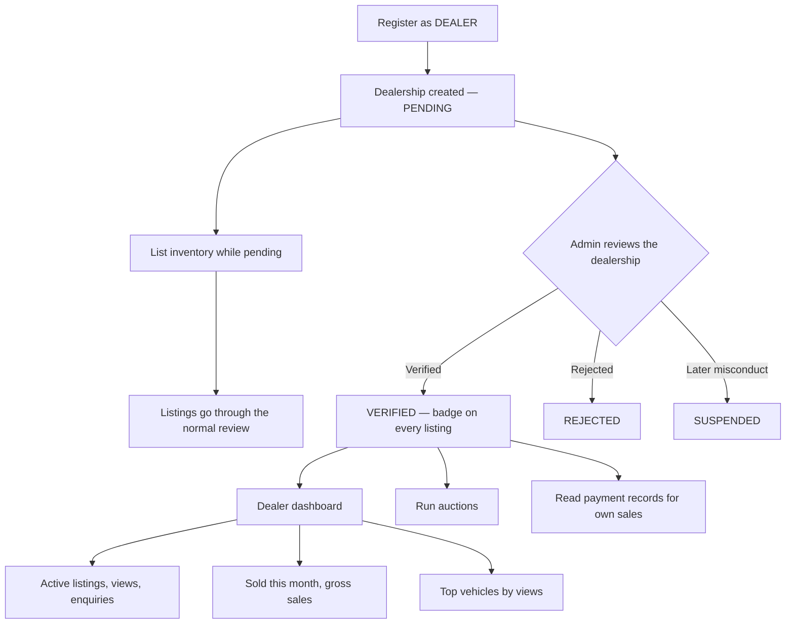

**A pending dealer is not blocked from selling.** Verification affects the
badge and buyer trust, not the ability to list. That is a product choice, not
an oversight — a new dealership can start working the day it registers.

## Inspector

Independent condition reporting. The narrowest role in the system, and
deliberately so.

| Can | Cannot |
| --- | --- |
| See inspections assigned to them | List a vehicle |
| Create an inspection record | Bid on anything |
| Grade each section and submit the report | Edit a submitted report |
| Read any published report | See dealer or platform analytics |
| | Moderate listings |

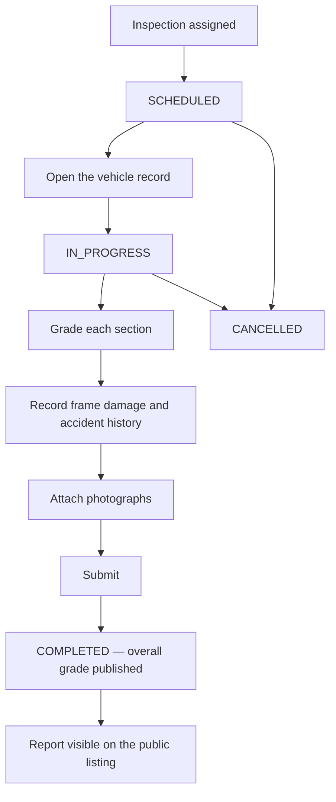

The report is what a buyer leans on, so the inspector must not be able to sell
the thing they graded. `INSPECTOR` holds exactly three permissions:
`vehicle:read`, `inspection:read`, `inspection:write`.

## Admin

Platform operations. Everything except the keys to the platform itself.

| Can | Cannot |
| --- | --- |
| Moderate listings — approve or reject | Change platform settings |
| Verify, reject or suspend a dealership | Manage payments |
| Suspend or deactivate a user account | Bid |
| Manage any auction | |
| Write inspections | |
| Read platform-wide analytics | |
| Read the append-only audit log | |

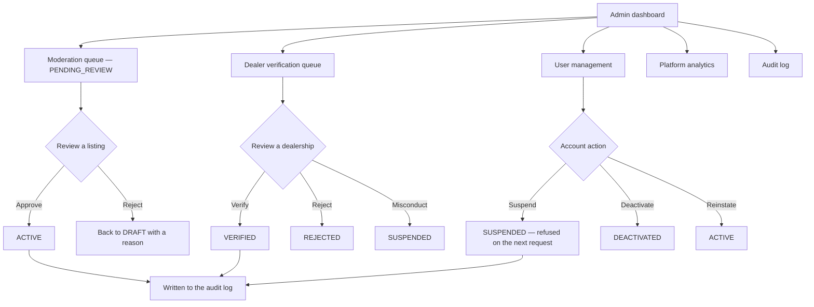

**Suspension takes effect on the next request, not at token expiry.** The JWT
strategy re-reads the user from the database on every request, so a suspended
account loses access within one round trip rather than up to fifteen minutes
later.

## Super admin

Holds every permission, including the one nobody else has: `settings:manage`.

| Can | Notes |
| --- | --- |
| Everything an admin can | |
| Manage platform settings | The only role with `settings:manage` |
| Manage payments — refunds, corrections | Shares `payment:manage` with sellers, dealers and admins, who use it to record payment on their own sales |
| Place bids | An artefact of holding every permission |

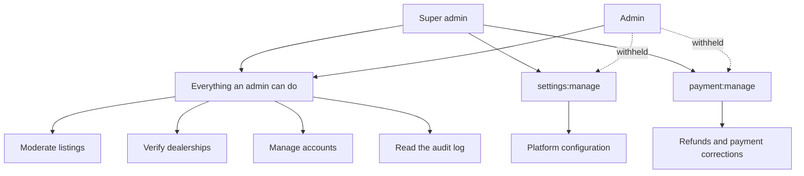

Money and configuration are separated from day-to-day moderation on purpose:
the account that suspends users is not the account that can move funds. An
admin can remove a listing at three in the morning without also being able to
issue a refund.

---

# Transaction flows

## 1. Registration and email verification

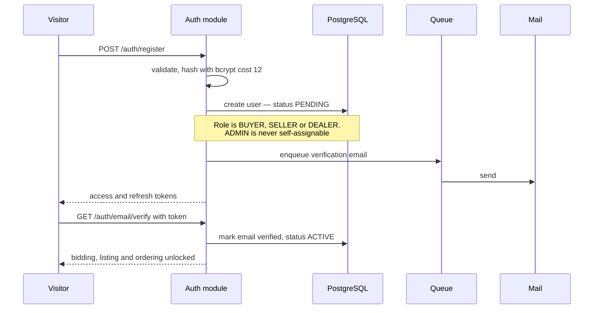

Registering with the `DEALER` role and a dealership name creates the `Dealer`
record at `PENDING` in the same transaction — a dealer account without its
dealership would be a meaningless half-state.

## 2. Sign-in and token rotation

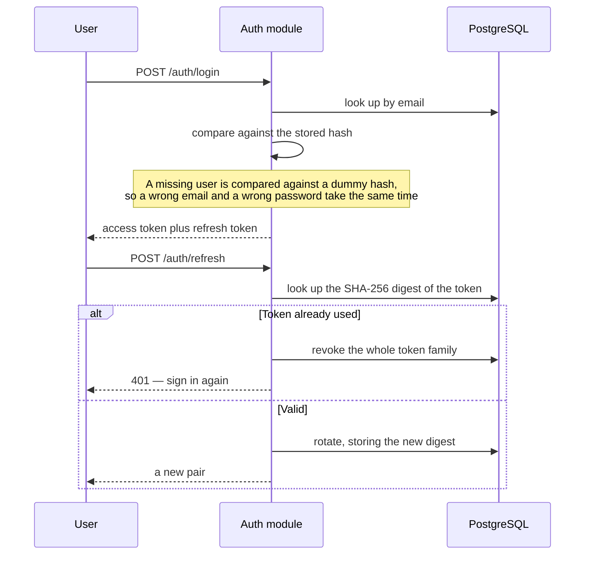

Replay of a refresh token is treated as theft: the entire family is revoked
rather than only the reused token.

## 3. Listing lifecycle

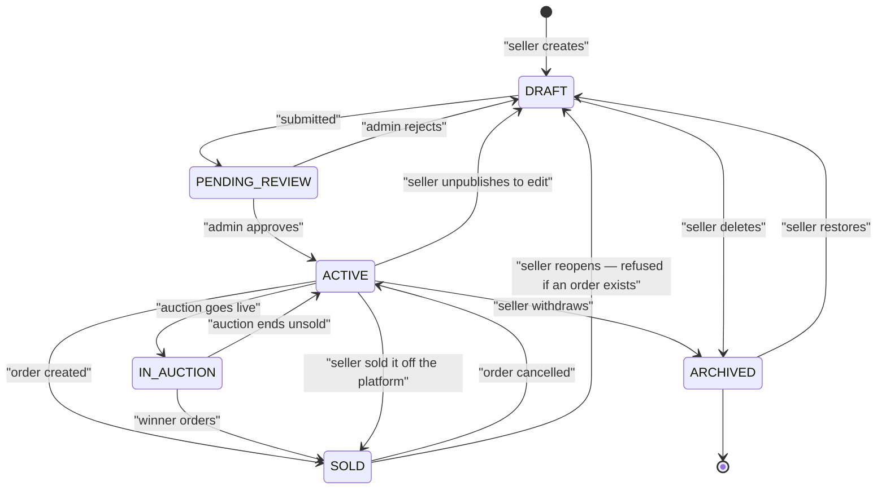

`GET /vehicles/:idOrSlug` returns an unpublished listing to its owner and to an
admin. To everyone else it is a **404, not a 403** — a 403 would confirm the
listing exists, which is enough to probe for ids.

A seller previewing their own listing does not inflate its view count.

## 4. Moderation

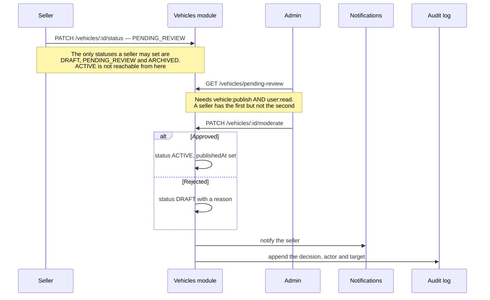

Publication is a decision, so it has exactly one door. `PATCH /vehicles/:id`
cannot set `status` at all — the update schema omits the field, and the handler
spreads validated input straight into the write, so anything the schema accepts
is something the caller can set. `PATCH /vehicles/:id/status` accepts only the
statuses above, and checks the transition against the listing's current state.
A published listing can be unpublished to `DRAFT` in one step — that costs the
seller their approval, which is the point — but an archived listing returns to
`DRAFT` rather than straight back to review.

A seller may also mark a vehicle `SOLD` from any state that is on the market.
Cars are sold on the forecourt and in driveways, and a listing that cannot say
so is a listing people stop trusting; marking it sold is also better than
archiving it, because the vehicle stays visible with its outcome and
time-to-sale reporting keeps working. It is not a moderation bypass — it takes
a listing off sale rather than putting one up. Two guards apply to everyone,
administrators included: a vehicle in a scheduled or live auction cannot be
marked sold, and a vehicle sold through a real order cannot be reopened by
relabelling it — cancelling the order is what returns it to the marketplace.

`IN_AUCTION` is absent from both, because it describes a running auction rather
than a choice a seller makes; the auction flow sets and clears it.

## 5. Fixed-price purchase

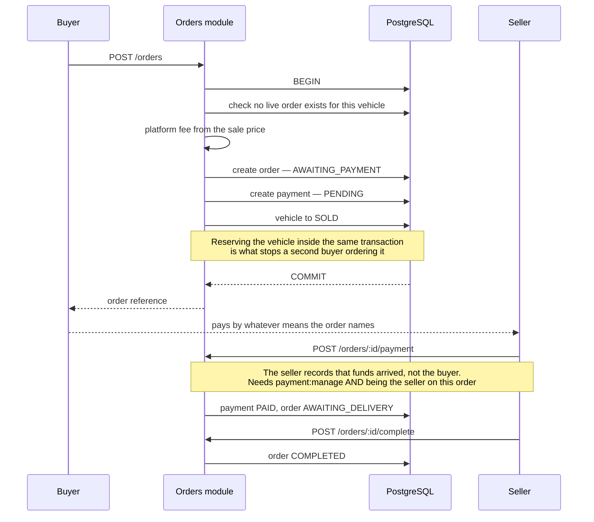

### Order states

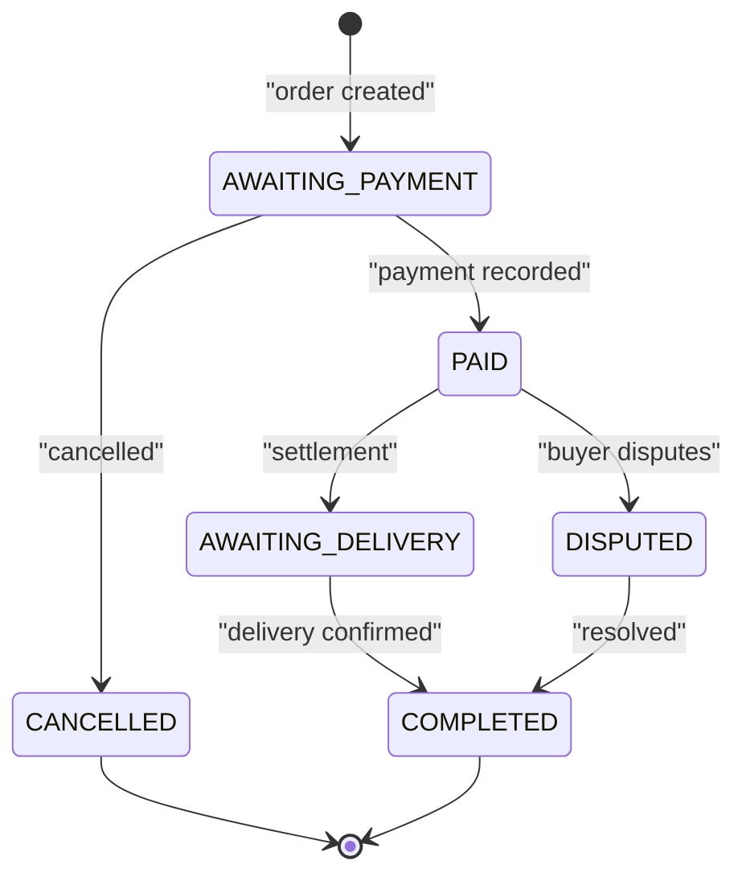

Cancelling releases the vehicle: the order goes `CANCELLED`, the payment goes
`CANCELLED`, and the vehicle returns to `ACTIVE` with `soldAt` cleared.

### The fee

Charged on the sale price, added to the buyer's total:

| Sale price | Fee |
| --- | --- |
| $1,000 | $150 — the floor |
| $20,000 | $1,000 |
| $1,000,000 | $2,500 — the ceiling |

The floor keeps small lots worth processing; the ceiling stops a percentage
becoming absurd on an expensive vehicle.

## 6. Auction lifecycle

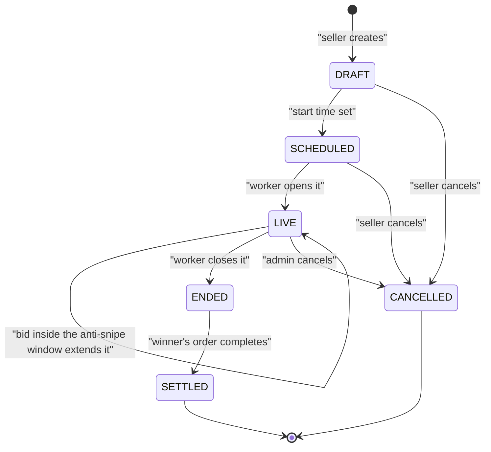

## 7. Placing a bid

The most correctness-sensitive path in the platform.

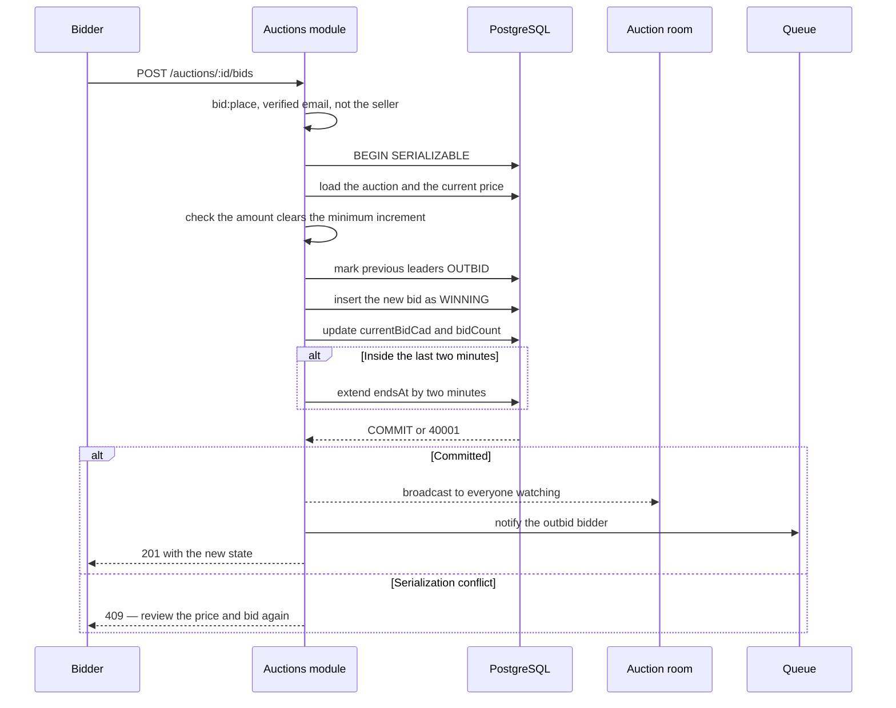

**Why serializable.** Two bidders hitting the same auction in the same
millisecond must not both be told they are winning. PostgreSQL aborts one and
the caller gets a 409 telling them to look at the new price — an honest answer
instead of a silently lost bid.

Verified under load: ten simultaneous bids produced two accepted, seven
serialization conflicts and one below-minimum rejection, leaving exactly one
`WINNING` row.

### Minimum increments

| Current price | Minimum raise |
| --- | --- |
| Below $5,000 | $100 |
| $5,000 – $19,999 | $250 |
| $20,000 – $49,999 | $500 |
| $50,000 – $99,999 | $1,000 |
| $100,000 and above | $2,500 |

### Bid states

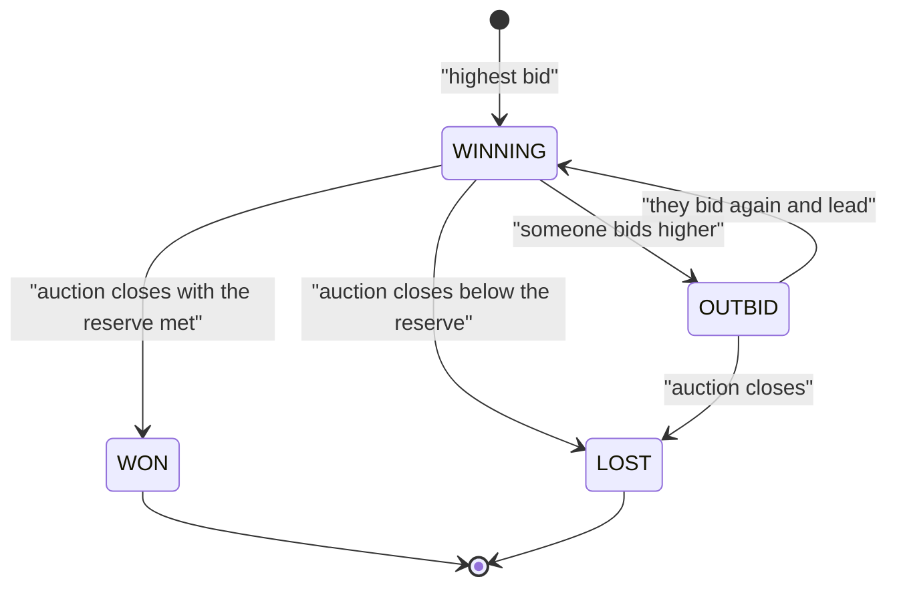

## 8. Auction close and settlement

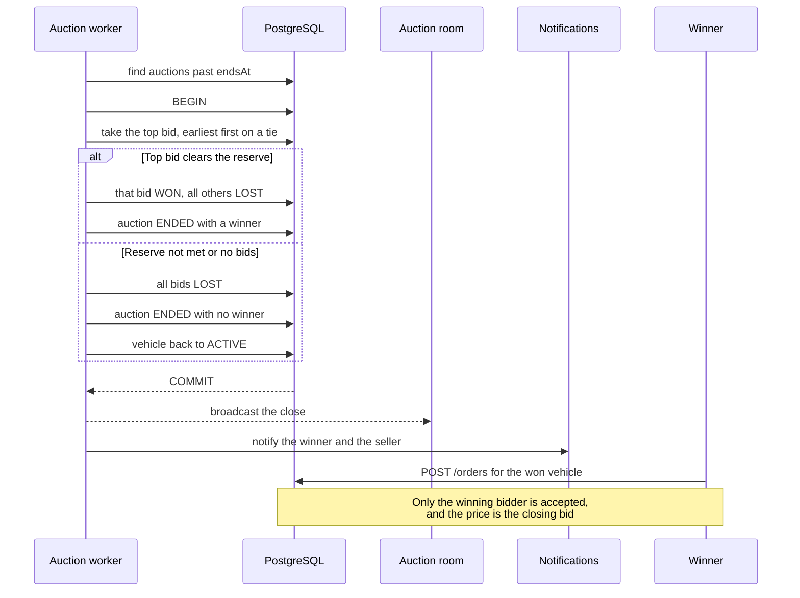

Closing is idempotent. An auction already `ENDED` or `SETTLED` is left alone,
so a worker that runs twice cannot pick a second winner.

The reserve is never exposed. The API returns `reserveMet` and `hasReserve`;
the amount itself never leaves the server.

## 9. Inspection

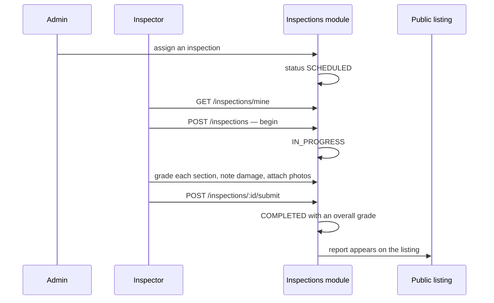

A completed report cannot be edited by its author. Correcting one means a new
inspection, which leaves both in the record.

## 10. Dealer verification

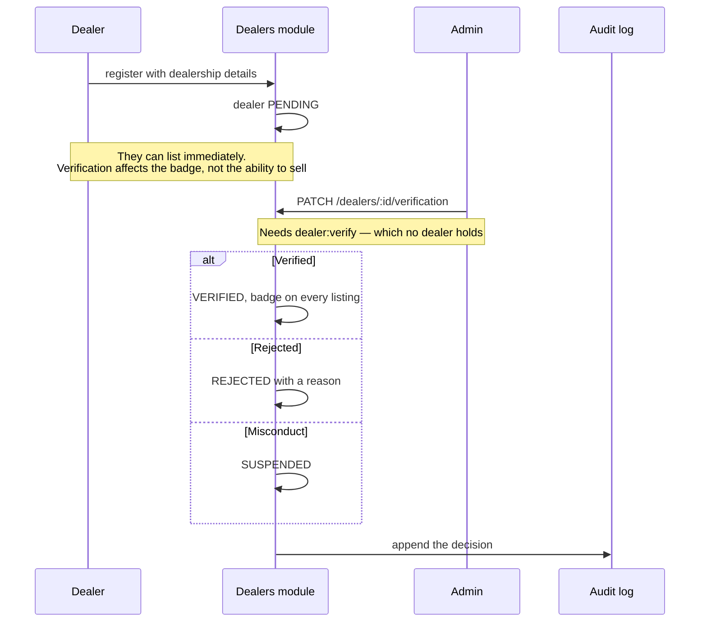

## 11. Messaging

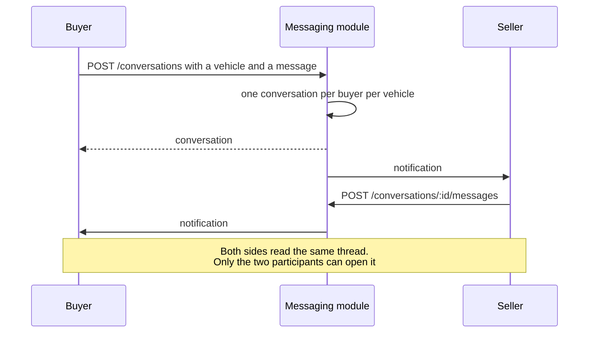

The uniqueness constraint on `(vehicleId, buyerId)` is what stops a buyer
opening five threads about the same car.

## 12. Account suspension

```mermaid
sequenceDiagram
    participant A as Admin
    participant API as Users module
    participant U as The user
    participant L as Audit log

    A->>API: PATCH /admin/users/:id/status — SUSPENDED
    API->>L: append actor, target and reason
    U->>API: any request with a still-valid token
    API->>API: JwtAuthGuard re-reads the user
    API-->>U: 403 — the token is valid but the account is not
```

## 13. Audit

Every security- and money-relevant action is appended, never updated:
moderation decisions, dealer verification, account status changes, order
transitions, payment records. `audit:read` gates the query, so an admin can
read the trail and a dealer cannot.

---

# Status reference

| Entity | States |
| --- | --- |
| User | `PENDING` · `ACTIVE` · `SUSPENDED` · `DEACTIVATED` |
| Dealer | `PENDING` · `VERIFIED` · `REJECTED` · `SUSPENDED` |
| Vehicle | `DRAFT` · `PENDING_REVIEW` · `ACTIVE` · `IN_AUCTION` · `SOLD` · `ARCHIVED` |
| Auction | `DRAFT` · `SCHEDULED` · `LIVE` · `ENDED` · `SETTLED` · `CANCELLED` |
| Bid | `ACTIVE` · `OUTBID` · `WINNING` · `WON` · `LOST` · `RETRACTED` |
| Order | `INITIATED` · `AWAITING_PAYMENT` · `PAID` · `AWAITING_DELIVERY` · `COMPLETED` · `CANCELLED` · `DISPUTED` |
| Payment | `PENDING` · `AUTHORIZED` · `PAID` · `PARTIALLY_REFUNDED` · `REFUNDED` · `FAILED` · `CANCELLED` |
| Inspection | `SCHEDULED` · `IN_PROGRESS` · `COMPLETED` · `CANCELLED` |

# What these flows do not cover

- **Payments are recorded, not processed.** `POST /orders/:id/payment` stores a
  provider reference that something else must produce. There is no gateway, no
  authorisation hold and no settlement to a seller's bank account. The
  authorization around it says who may make that assertion; nothing verifies
  that the assertion is true, which is why a signed provider webhook has to
  replace this endpoint before it carries real money.
- **Disputes have a status but no workflow.** `DISPUTED` exists on the order;
  what happens next is a manual conversation.
- **Refunds are a permission without a flow.** `payment:manage` covers recording
  payment today; the refund and correction endpoints it is also meant to gate
  have not been built.
- **Proxy bidding is stored, not automated.** A bid can carry a ceiling, but
  nothing bids on the buyer's behalf as the price rises.

See [future work](./reference/future-work.md).
